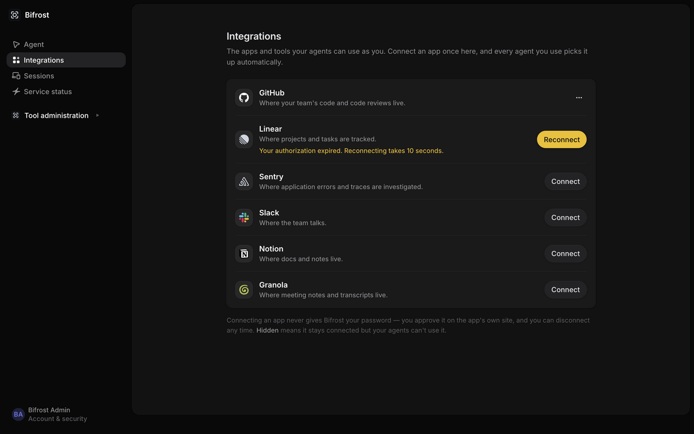
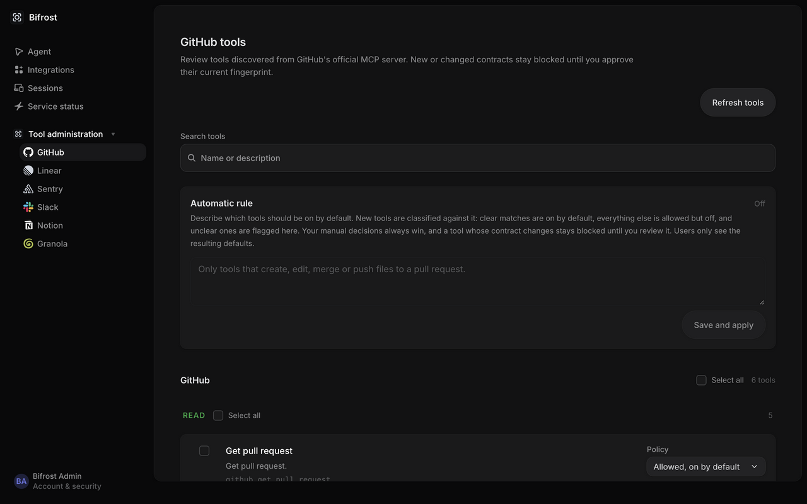
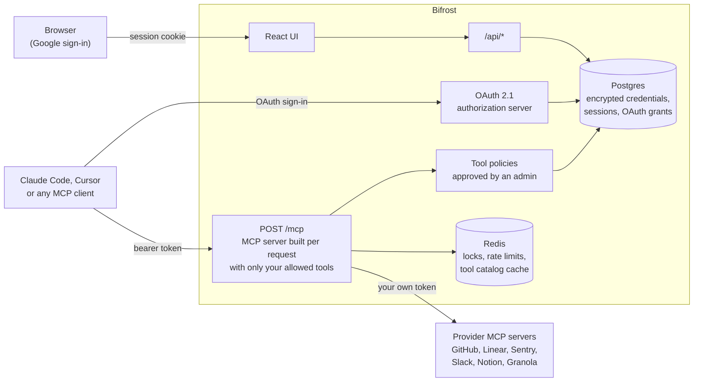

# Bifrost

Bifrost is a small gateway between your coding agent and the tools your team uses. You sign in with Google and connect your GitHub, Linear, Sentry, Slack, Notion and Granola accounts once. After that, Claude Code or any other MCP client can use those tools through a single URL. The agent works with your identity and your permissions, but it never sees your tokens: they stay encrypted on the server. An administrator approves each tool before anyone can use it, and each user can switch tools on or off.

Bifrost also has a web chat. It can use the same tools as your agent, and administrators can use it to review and approve tools.





_Screenshots use the built-in mock API (`VITE_USE_MOCK_API=true`), so no real accounts are shown._

---

## Why it exists

Giving an AI agent access to your team's tools usually means one of two bad options: paste a personal access token into a config file on your laptop, or share a bot account whose actions nobody can attribute to a person. Bifrost replaces both with one internal gateway. Tokens stay on the server, every action is done by a real person's account, and an administrator decides which tools exist at all.

## How it works



Three ideas explain most of the design:

1. **The MCP server is rebuilt on every request.** Bifrost loads the caller's connected providers and tool preferences and registers only those tools. A hidden tool is not just missing from `tools/list`; it cannot be called, because it was never registered for that request.
2. **Bifrost is on both sides of OAuth.** It is an OAuth _client_ to Google and to each provider (this is how it gets your tokens), and an OAuth 2.1 _authorization server_ to MCP clients (this is how Claude Code gets its own credential). Clients hold a 1-hour access token and a rotating 90-day refresh token, so agent access does not silently expire.
3. **Two people decide what a tool may do.** An administrator approves the exact version of a tool discovered from the provider. Then each user can turn approved tools off for themselves.

## Security model

- **Provider tokens never leave the server.** They are encrypted with AES-256-GCM, bound to their database row, and decrypted only to make an outbound call. Keys can be rotated online ([docs/encryption-keys.md](docs/encryption-keys.md)).
- **Agents get their own short-lived credentials.** Bifrost tokens are opaque and stored as SHA-256 hashes. A reused refresh token revokes the whole grant. Browser cookies and agent bearer tokens are checked by separate code against separate tables, and both re-check the sign-in allowlist on every request, so removing someone from it ends their access right away.
- **New and changed tools start blocked.** Each tool contract has a fingerprint. Any change to the contract creates a new fingerprint, and the tool stays blocked until an administrator approves it. When the admin web chat wants to change a policy or a rule, it shows the exact change and waits for the administrator to approve it.
- **Everything fails closed.** A missing policy, a missing tool, a fingerprint mismatch or an unavailable Redis means "no access", not a default. Logs redact tokens and secrets.

More detail: [docs/tool-visibility.md](docs/tool-visibility.md), [docs/oauth.md](docs/oauth.md) and [docs/request-lifecycle.md](docs/request-lifecycle.md).

## What agents get

Bifrost discovers tools from each provider's official MCP server with the user's own OAuth token. It adds a prefix to each name (`github_`, `linear_`, and so on), keeps the original schemas and annotations, and forwards approved calls. A tool without `readOnlyHint: true` is treated as able to write.

Discovered tool lists are cached in Redis for one hour. Tool calls reuse the cached definition but always read the current policy from Postgres, so blocking a tool takes effect immediately. An upstream error clears the cache for that provider. Approving tools always fetches a fresh list from the provider first.

### Web chat and automatic tool rules

The web chat uses the Vercel AI SDK with Anthropic's Claude. The default model is Claude Sonnet 5.5 (`claude-sonnet-5-5`) at `high` effort, set by `ANTHROPIC_MODEL` and `ANTHROPIC_EFFORT`. It sees the same tools as the signed-in user's agent, finds them with Anthropic's tool search instead of loading every definition up front, and can search the web. If Claude declines a request, the API first retries it on a fallback model, and the chat says so plainly if that one declines too. Chat history stays in the browser (IndexedDB).

Administrators can write one plain-language rule per provider, such as "only tools that read issues". Bifrost then sends the name, description, access type and parameter names of each new tool to Jev, the classifier model set by `JEV_MODEL` (default `typesafe/jev-1.13`), through OpenRouter. Jev returns a probability that the tool matches the rule, and Bifrost turns it into "on by default" or "off by default" ([src/server/tools/rule-classifier.ts](src/server/tools/rule-classifier.ts)). A rule never blocks a tool, never changes an administrator's decision, and never re-approves a tool whose contract changed: that tool stays blocked until an administrator reviews it. Without `OPENROUTER_API_KEY`, new tools wait for an administrator.

## Quick start

Requirements: Docker with Compose v2, and OAuth apps for Google and for GitHub or Slack if you want those providers. Linear, Sentry, Notion and Granola need no app setup (see [SETUP.md](SETUP.md)).

```bash
cp .env.example .env
openssl rand -base64 32     # paste into ENCRYPTION_KEY in .env
docker compose up --build
```

Open <http://localhost:3000>, sign in with Google, and connect a provider from **Integrations**. Migrations run when the container starts. The server refuses to start without `ENCRYPTION_KEY`. Compose runs in development mode; see [SETUP.md](SETUP.md#10-running-in-production) for production.

### Connect an agent

Bifrost implements the MCP `2026-07-28` authorization spec, so a compliant client needs only the URL:

```bash
claude mcp add --transport http bifrost https://bifrost.your-company.dev/mcp
```

The client finds the authorization server, opens the browser for consent, and stores its own token. **Agents & sessions** in the UI lists every connected client and lets you revoke any of them.

## Configuration

Settings are environment variables, checked at startup by `src/server/config.ts`. These are the ones you need to know first; [SETUP.md](SETUP.md#configuration-reference) lists all of them.

| Variable | Required | What it does |
| --- | --- | --- |
| `ENCRYPTION_KEY` | yes | 32-byte base64 key for provider credentials. There is no default. |
| `PUBLIC_URL` | yes in prod | The origin agents and OAuth redirects use. Default `http://localhost:3000`; must be `https` in production. |
| `DATABASE_URL` | yes | Postgres. Outside Docker, use `localhost:5432`, not `postgres`. |
| `REDIS_URL` | in prod | Shared locks, rate limits, tool caches and browser events. Production refuses to start without it. |
| `GOOGLE_CLIENT_ID` / `_SECRET` | yes | Google sign-in. |
| `ALLOWED_EMAIL_DOMAINS`, `ALLOWED_EMAILS` | recommended | Who may sign in. **If both are empty, any verified Google account can sign in.** |
| `ADMIN_EMAILS` | recommended | Exact emails that may approve tools. **If empty, every tool stays blocked.** |
| `ANTHROPIC_API_KEY` | for chat | Turns on the web chat. Bifrost starts without it. |

## Development

```bash
bun install
npm run dev                  # Postgres + Redis containers, migrations, API on :3000, Vite on :5173
npm run verify               # lint, format check, both typechecks, unit tests with coverage, build
npm run integration -- test  # integration tests against throwaway Postgres + Redis (needs Docker)
npm run db:generate          # new Drizzle migration after changing src/server/database/schema.ts
```

Work against <http://localhost:5173>; Vite forwards `/api`, `/auth`, `/oauth` and `/mcp` to the API. The Docker image has its own copy of `dist`, so after changing code run `docker compose up -d --build app`. Parallel worktrees, the mock API and the development-user header are described in [docs/verification.md](docs/verification.md).

## Where to look first

- [`src/server/mcp.ts`](src/server/mcp.ts): builds the MCP server for each request and registers only the caller's visible tools.
- [`src/server/tools/filter.ts`](src/server/tools/filter.ts): the visibility filter. Every axis fails closed.
- [`src/server/oauth-server/`](src/server/oauth-server/): the OAuth 2.1 authorization server (PKCE, client metadata documents, refresh rotation with replay detection).
- [`test/integration/`](test/integration/): the real MCP, OAuth grant, token refresh and key rotation paths against Postgres, Redis and a fake upstream MCP server.

[AGENTS.md](AGENTS.md) is the index for anyone changing the code; each topic has its own file under [`docs/`](docs/).

## Layout

```
src/
  app/               React SPA, route-colocated UI and browser entrypoint
  server/            Hono, MCP, OAuth, providers, persistence and Node entrypoint
  features/          cross-runtime product contracts, including the Hono RPC client
migrations/          generated Drizzle SQL, applied on container boot
test/                vitest unit tests; test/integration needs Postgres and Redis
bench/               latency benchmarks for the MCP hot path
```

## How this was built

Bifrost was built with coding agents writing most of the code, guided by [AGENTS.md](AGENTS.md) and the docs it links.
Every change has to pass `npm run verify`: lint, formatting, strict typechecks, unit tests with a coverage gate, and both builds.
CI runs the same command on every push, with real Postgres and Redis, so it also runs the integration tests.

## Known limitations

- Agents get a single OAuth scope, not one per provider.
- The encryption master key lives in an environment variable (no KMS).
- No end-to-end or UI tests; tests cover the server.
- No audit table yet: tool calls only go to the logs.
- Redis is required in production and is a single point of failure by design.

Details and smaller gaps are in [docs/gotchas.md](docs/gotchas.md#known-gaps).

## License

[MIT](LICENSE)
